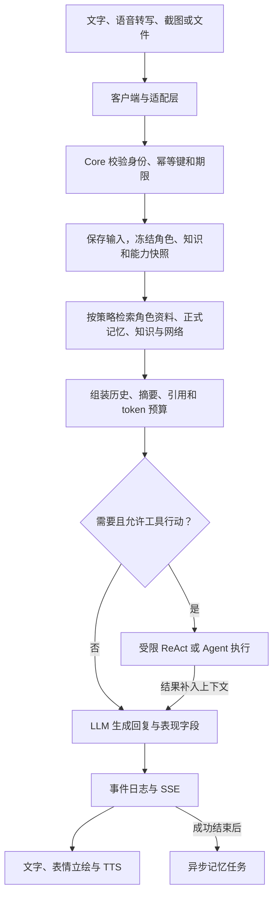
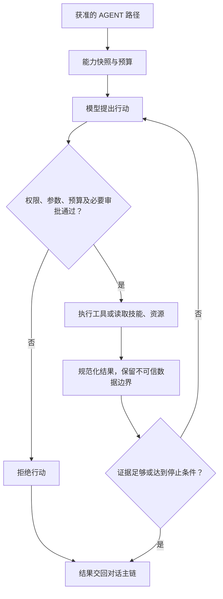
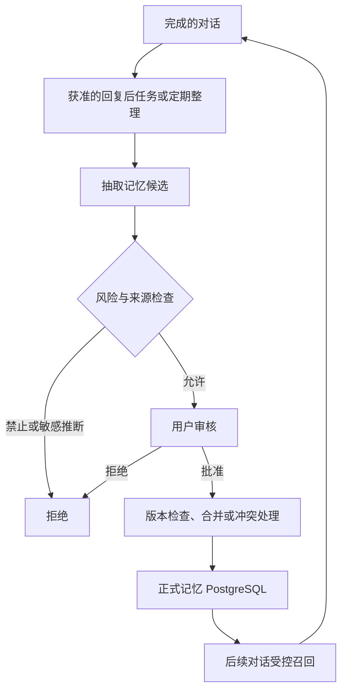
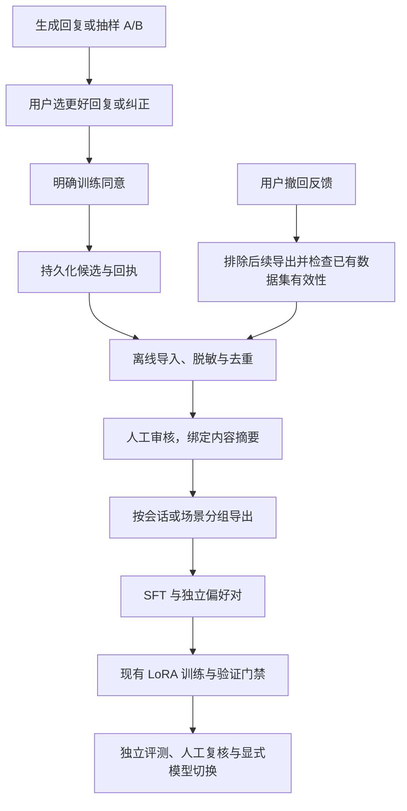
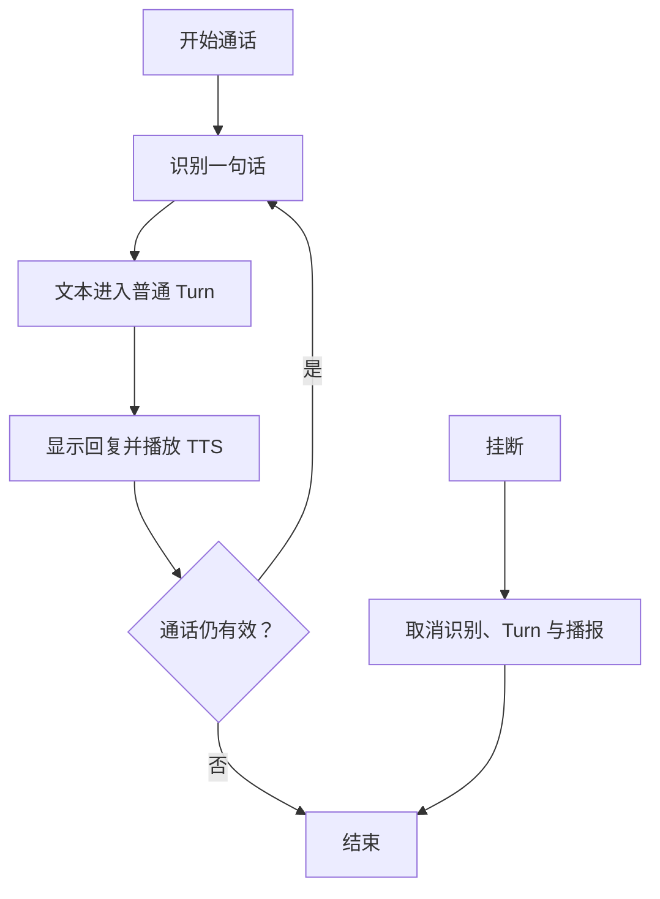

# Meguri 主流程、学习闭环与 P0 实施记录

更新日期：2026-10-08（Asia/Shanghai）。本文用于阅读和学习，并记录本次代码实现、测试和环境验收；运行规范仍以现有 0–7 / 20.x 页面为准。

最新状态：三个 P0 已完成，OpenSpec 21/21。正式记忆继续使用已有服务器库；本机 Java Runtime 已启用同一服务器上的独立 `meguri_turn_runtime` 库。真实 Core、网关与原生客户端重启恢复验收通过。

## 1. 项目介绍与阅读顺序

Meguri-pet 是以角色陪伴为中心，结合长期记忆、工具执行、语音和多端交互的 AI 桌宠系统。Java Core 负责对话编排，Python 服务承载正式记忆等能力，客户端负责文字、立绘、表情和声音呈现。

先读本页理解调用链，再按问题进入现有规范：[训练 B](https://app.notion.com/p/3aaa3636596381e5b3a7efdfd076c848)、[恢复 5](https://app.notion.com/p/3a8a363659638144aad4eecda46c7c1d)、[部署证据 E](https://app.notion.com/p/3aaa36365963811aa9f6fd9cc581961c)。[2026-09-17 AI 强化补充](https://app.notion.com/p/3dea363659638109a595fa495612ba18)仍是专项方案，本次只实现与三个 P0 对应的反馈、数据桥接和恢复验证，不表示 Companion Director、全双工语音等整个方案已经完成。

## 2. 对话主流程



FAST / THINK / AGENT 决定执行方式；NONE / FAST / SLOW 决定检索深度。它们是两个独立维度。身份、权限、期限与预算由服务端校验。事件序号支持去重、重连和回放；内存实现只能跨连接恢复，正式跨进程恢复需要持久化配置。

主要代码：`java/meguri-core/.../runtime/CanonicalTurnPipeline.java`、`TurnOrchestrator.java`。

## 3. ReAct 工具执行循环



期限、轮数、调用次数、token、成本、重复行动、连续失败或无新信息均可结束循环。ReAct 解决当前任务，不直接改变模型权重；工具结果也不会自动成为正式记忆或可信系统指令。

## 4. 长期记忆增强



原生桌面开启正式记忆和自动整理后，默认每 10 个成功话轮整理；读取最近最多 20 条消息，提交最多 3 条结构化候选。默认候选需要审核。正式记忆与训练许可分别管理。

2026-10-06 接入记录确认：原生桌面 → 网关 15173 → Java 18080 → Python 8000 → 服务器 PostgreSQL 独立记忆库；provider 为 native_pgvector，schema 为 20260729_0007。目前 embedding 和 reranking 关闭，实际召回使用文本。记忆库持久化不等于 Java Turn/上下文已启用持久化。

## 5. 用户监督与模型学习



上图的原生反馈、持久化回执和离线数据桥接已完成代码与验收；新模型训练与上线仍需另行执行门禁。实现前的状态是：后端与旧 desktop-airi 页面已经支持反馈；原生 desktop-meguri 没有反馈界面；反馈 JSONL 没有进入训练的导入器。后端默认对比采样率是训练模式 3%、普通模式 0.1%。

文本训练权重只学习角色风格、格式和安全习惯。动态用户事实属于正式记忆，不靠每日重训保存。行为纠正文字本身不是合格的 assistant 标签：需要选择已有合法回复，或由审核人提供经过审核的结构化正确答案。

模型 Registry 当前有 evaluated 的 Qwen3.5-4B 候选；Staging candidate_enabled 为 false。数据准备、训练成功、评测通过和模型上线是不同状态。Locked Eval 不进入训练、选模或调参。

## 6. 持续语音与工作转交



当前是轮流说话模式：思考和播报期间暂停识别，播报后继续听。全双工插话、连续 ASR 和流式 TTS 仍是后续方向。天气、待办、日报有额外定时或事件入口。本机 Codex / Harness 转交使用任务卡 → 用户确认 → 一次投递 → 回执，执行权归对应执行器。

## 7. 本次 P0 与已有 Notion 方案的对应

| 本次项 | 既有方案 | 实现前缺口 |
| --- | --- | --- |
| 原生反馈入口 | 2026-09-17 强化补充第 8 节：可见、可撤销、不过度采样 | 旧页面有 UI，原生端未接入；待反馈 map 重启丢失 |
| 反馈接入训练 | B 第 8–11 节：权重职责、样本版本、评测、Registry；17 历史计划仅作追溯 | 用户监督没有审核导入与导出链，训练门禁仅认原有精确基线 |
| 持久化与重启验证 | 5 第 14–15 节：PostgreSQL 事件权威、重启与副作用；E 部署证据规则 | 实现已有，但本机默认 volatile；需独立配置和真实证据区分 |

OpenSpec：`complete-p0-learning-and-runtime-recovery`（spec-driven）。代码、隔离测试及本机正式 PostgreSQL Runtime 启用/真实客户端恢复验收均已完成。此前待配置状态已由本次实际启用证据替代。

## 8. 后续改进建议

P1：建立记忆同义改写、时间变化、冲突事实评测，再验证向量与重排；将第二候选采样迁到后台并测量首字、完整回复与起播时延；完善连续识别、插话取消和已播文本对齐。

本次核对还发现两个需要单独审批数据版本的问题：当前运行提示词摘要与 B 已批准训练提示词不同；原始 B train/validation 存在 4 对规范化后的重复输入/目标。桥接使用 B 固定提示词，并阻止反馈重复进入任一基线 split；本次不重写已批准基线。后续应做新版基线去重与提示词对齐评估。

P2：收敛约 2700 行 TurnOrchestrator 的生成、规划、收尾与反馈职责；同步早期 mock 文档与当前本机、服务器配置；继续完善 Companion Director 和表现偏好，但保留用户明确许可与可撤销边界。

## 9. 证据与状态规则

代码实现、离线测试、隔离 PostgreSQL 重建/进程重启、真实桌面端验收和生产部署分别记录。不上传用户原始聊天、训练反馈、数据库凭据、API key 或令牌。不把准备好的训练数据写成已训练，不把隔离测试写成正式生产验收。

## 10. P0 实施后状态

| 项目 | 已完成 | 实际运行边界 |
| --- | --- | --- |
| 原生用户监督 | 默认关闭的训练模式；可选 A/B 与行为纠正；每次明确同意；稳定回执、刷新和撤回 | 实际 Core/网关已重启；隔离用户配置的原生 Electron 界面经真实网关完成对话、保存和撤回；用户日常训练开关仍由本人选择 |
| 反馈恢复与权限 | 原子写入待反馈档案，文件锁保护多进程提交；提交/撤回意图可重放；JSONL v2 记录同意版本与撤回标记；错误身份与冲突重试拒绝 | 本地监督档案独立于 PostgreSQL Turn 权威，不属于正式记忆；写入失败不会让正常回复失败 |
| 反馈训练桥 | 只读导入、模式脱敏、摘要绑定人工审核、分组去重导出；独立偏好对；新增明确的反馈增强 Manifest 分支 | 原始基线 2626/566 门禁保持；源文件或审核台账变化使旧导出失效；没有训练或切换模型 |
| Runtime 恢复 | 专用连接文件启动选择、配置失败拒绝降级、显式内存回退；真实 PostgreSQL 与独立 JVM 验证通过；修复恢复 SQL、Spring 注入、Capability 集合比较和 PowerShell 5.1 启动兼容 | 本机 Core 已通过 postgres profile 使用服务器独立 `meguri_turn_runtime`；完成两次实际 Core/网关重启和原生客户端恢复验收 |

反馈选择只会在对应话轮仍是当前会话叶节点时更新上下文；完成事件保持原始结果。对旧话轮的选择不会覆盖后来内容相同的新话轮。旧 AIRI 入口也改为每次勾选明确同意，并使用有身份的代理和稳定提交键；其反馈许可不授予正式记忆管理能力。

## 11. 如何使用原生反馈

1. 更新后重新启动 Core、桌面网关和 Meguri；在“隐私与数据”允许网络对话。
2. 在“设置 → 监督与训练”开启训练模式。它给后续回复提供纠正入口，偶尔提供两种回复；开关本身不代表本次训练同意。
3. 展开某轮“比较回复 / 纠正这次回复”，选择回复或写行为纠正，再勾选本次训练许可并保存。
4. 保存成功才显示回执。失败可保留原内容重试；状态不确定时先刷新。设置页可以管理当前会话候选和此前会话回执。
5. 点击“撤回训练许可”保存排除标记；后续导出排除这条反馈。已完成的训练不会被自动逆转。

默认服务端监督路径是 `%USERPROFILE%\.meguri\training\behavior-feedback.jsonl`，待反馈档案为同目录下的 `behavior-feedback.jsonl.pending`。反馈草稿遵守本机保存历史开关；回执只保存身份和状态元数据以便撤回。不要上传这两个包含私人对话的监督文件。

## 12. 如何从反馈准备离线数据

在 `D:\program\meguri-pet` 下执行。命令里的候选编号、摘要、审核别名和输出路径须替换为实际值。导入不会自动审批。

```powershell
$feedbackPython = 'D:\environment\anaconda3\envs\py314\python.exe'
& $feedbackPython -m training.llm.scripts.feedback_dataset import `
  --source "$env:USERPROFILE\.meguri\training\behavior-feedback.jsonl"
```

查看返回 import_dir 下的 `pending.jsonl`、`import_report.json` 和 `import_manifest.json`。初次模式脱敏不保证去掉所有私人事实；审核时检查个人事实、秘密、回复格式与角色行为，不能安全用于风格训练的条目应拒绝。

```powershell
& $feedbackPython -m training.llm.scripts.feedback_dataset review `
  --import-dir <import_dir> --ledger training/llm/artifacts/feedback/reviews.jsonl `
  --feedback-id <feedback_id> --candidate-digest <candidate_digest> `
  --decision approve --reviewer <审核别名> --privacy-reviewed `
  --language zh --relationship-stage sibling --outfit-code 01 --interaction-mode work
```

审核人填写该回复实际对应的语言、关系、服装与模式，不能全部沿用例子的值。只有纠正说明而无已选合法回复时，需要追加 `--corrected-response <完整结构化回复JSON文件>`；说明文字不能直接当回复标签。拒绝或撤销审核使用 `--decision reject` 或 `revoke`，无需填训练运行状态。

```powershell
& $feedbackPython -m training.llm.scripts.feedback_dataset build `
  --import-dir <import_dir> --ledger training/llm/artifacts/feedback/reviews.jsonl `
  --baseline-dir training/llm/artifacts/datasets/meguri-text-sft-v1-532aca8b1a5d `
  --split-root data/meguri/aligned_v1/splits
& $feedbackPython -m training.llm.scripts.feedback_dataset validate --dataset-dir <dataset_dir>
```

导出包含 `train.jsonl`、`validation.jsonl`、`preferences_train.jsonl`、`preferences_validation.jsonl`、已审核来源/决定副本、质量报告与 Manifest。SFT 包含原始 B 基线和增量反馈；偏好对独立保存，不会自动启用 DPO。相同会话、场景和重复目标按相连分组放入一个 split；locked scene 只读编号元数据并排除。增量版本可用 `--previous-dataset <上次目录>` 固定之前分组归属。

新增反馈、撤回或审核台账变化都会让旧数据集失效。重新导入、核对摘要并审核、重建；不允许忽略这项错误。进入 GPU 实验前还需满足现有专用 LLM 环境、干净工作树、完整探测、smoke、评测和人工复核门禁。

## 13. Runtime 配置、验收与剩余门禁

正式启动使用单独的 `D:\environment\secrets\meguri\turn-runtime-database-url.txt`，或 `MEGURI_RUNTIME_DATABASE_URL_FILE` 指向另一个绝对路径。内容由运维配置为专用运行库与账号的 PostgreSQL URI。用户名和密码单独映射到 JDBC 配置；不将连接串写入仓库或 Notion，不复制记忆应用或迁移账号作为正式 Runtime 账号。

启动器会选择 `postgres` profile 和 Turn、事件、上下文、任务等持久化组件，移除排除 DataSource 的 `local-mock` profile。显式选择 postgres 但缺失/非法连接时拒绝启动；数据库不可用时拒绝启动。显式内存回退是 `MEGURI_TURN_JOURNAL_MODE=in-memory`，它也清除本进程的运行库凭据并选择 local-mock，不会伪装成持久化。

```powershell
./ops/scripts/test-runtime-postgres-config.ps1
./ops/scripts/check-runtime-postgres-recovery.ps1 -DatabaseSecretFile <可创建临时schema的测试连接文件>
```

第二条执行存储组件与完整 Core 两套验收，分别新建唯一 `meguri_p0_recovery_<随机值>` / `meguri_p0_core_<随机值>` schema，固定 search_path，仅在此创建合成话轮和任务。完整 Core 使用临时端口、临时用户目录和离线模型；finally 结束测试进程、删除本次精确 schema 并核对清理。它不初始化 public Runtime 表、不改正式记忆、不重启正在使用的 Core。

本次实际验收使用 PostgreSQL 16.13。组件验收确认完成回放保持 event ID、sequence、Turn ID 和幂等身份；会话恢复；中断生成保留 partial text，增加 `PROVIDER_STREAM_INTERRUPTED` 唯一终态；outbox 重投仍只有一个记忆任务，失去租约的旧 worker 不能确认新 worker 的任务。另启 writer JVM 结束后再启 reader JVM，读取相同完成话轮、上下文和待反馈档案。

此前完整应用隔离进程验收：三个 Spring Core JVM（PID 54548、69208、72656）依次启动，前一进程完全结束后才重启。带鉴权 HTTP 创建/查询、相同键重试、SSE 与 Last-Event-ID 回放、会话上下文、待反馈、保存回执、撤回和中断生成均通过。合成队列任务在失去租约后保留 job ID/digest，attempts 从 1 到 2；新进程正确跳过未获正式记忆许可的写入，旧 worker 无法确认。临时 schema `meguri_p0_core_66bbd81aa61e4b179585f3feac720ccb` 已清理。以下另记本机实际启用证据。

完整启动暴露并修复了两个组件测试未覆盖的缺陷：PostgreSQL session/context 对象注册为两个接口入口时存在 Spring 注入歧义，现指定上下文入口为 Primary；Capability 描述中的 Set 在不同 JVM 中可有不同 JSON 数组顺序，现按领域对象比较，避免同版本相同内容误判冲突。回归检查同时确认真正修改健康状态等同版本元数据时仍被拒绝。

按用户继续完成的要求，从现有同步服务器配置找到管理连接。既有服务器为 `111.228.35.186:5432`，正式记忆库 `meguri_memory` 已在使用；新增独立库 `meguri_turn_runtime` 和 `meguri_turn_owner`，后者没有 SUPERUSER、CREATEDB、CREATEROLE、REPLICATION。只授予其自有运行库的连接/建表权限，撤销新库 PUBLIC 权限。管理凭据只用于初始化，实际 Core 使用新建受限账号；未修改已有项目或记忆账号。

连接文件保存在上述专用外部路径，ACL 限所有者、SYSTEM 和 Administrators。启动器已自动选择 postgres profile，并成功初始化运行库表。实际 Windows PowerShell 5.1 启动暴露了无 BOM 中文脚本被误读以及 Split 重载差异，已保留 UTF-8 BOM 并显式选择有界 char-array 重载；Windows PowerShell 5.1 / PowerShell 7 的配置检查均通过。

实际链路：原生 Electron → 本机网关 `15173` → Java Core `18080` → 服务器运行库。Core PID `49108 → 10652 → 39312`，网关 PID `32836 → 44908 → 22024`；成功客户端进程 PID `32964 → 53388 → 12056`，使用独立测试用户目录，不更改日常客户端偏好。真实配置的 LLM 完成合成对话，Turn `turn_57e9b0ef52fa48c4` 在两次重启后保持同一幂等身份与全部 13 个 SSE 事件；会话快照仅请求生成时间变化，上下文图 revision 为 2。待反馈恢复后通过界面明确同意保存，下一次 Core/客户端重启读回同一回执并通过界面撤回。只读核验为 1 个 Turn、13 个事件、0 个正式记忆任务、0 个待反馈，回执状态 revoked；合成数据不会进入后续训练导出。

任务租约、中断生成、outbox 和上下文内部恢复另外在新专用库执行两套隔离测试：完整 Core 55.201 秒、组件/跨 JVM 41.668 秒，2 通过、0 失败/错误/跳过；临时 schema 均已清理。日志 `tmp/p0-dedicated-runtime-recovery.log`，真实客户端证据 `tmp/p0-native-live/`。这是本机正式启用与合成客户端验收，不代表远端托管 Core 部署、GPU 训练或全系统灾备认证。旧内存模式的历史事件无法由新库补造；本次启用后的话轮按 PostgreSQL 保存。

管理员 SQL 模板、文件配置、隔离检查、正式桌面验收和显式回退详见 [Turn Runtime 启用手册](../ops/runbooks/turn-runtime-activation.md)。

## 14. 测试证据

| 检查 | 结果 |
| --- | --- |
| Java 全量 | 589 tests：584 通过、5 个条件性跳过、0 失败/错误；真实 PostgreSQL 检查另行 opt-in 运行，含新增完整 Core 恢复验收 |
| 真实 PostgreSQL | 组件重建、独立 writer/reader JVM 和三个完整 Spring Core JVM 恢复均通过；HTTP/SSE、上下文、待反馈/回执、任务租约与真正元数据变更拒绝均覆盖 |
| Python 数据/训练门禁 | 44 tests 全部通过；实际 B 派生基线校验为 2626/566 |
| 原生反馈相关单测 | 4 files / 43 tests 全部通过 |
| 原生全量单测 | 343 通过、1 失败；失败为已有 reminder-flow 对“明天3点”的 clarify/review 断言，未修改提醒逻辑 |
| 类型检查 / Vite 构建 | 均通过；构建仍有既有较大 chunk 提示 |
| 网关与旧反馈入口 | 15 tests 全部通过 |
| Electron 界面 | 隔离模拟 API；明确同意、稳定提交键、保存回执、撤回、窄窗口与浅/深色截图通过 |
| 原生客户端实际恢复 | 真实网关/Core/服务器运行库；同一话轮、13 个 SSE 事件、待反馈、保存回执、撤回跨 Core 和客户端重启通过；测试使用隔离用户目录 |
| 配置脚本 | Windows PowerShell 5.1 / PowerShell 7 下，未配置、非法模式、postgres 缺失拒绝、专用 secret、profile 与显式回退均通过 |

本机 JDK 测试使用 `-Djdk.net.unixdomain.tmpdir=D:\program\meguri-pet\tmp` 规避长临时 socket 路径；不修改全局工具链。验收日志和截图保存在仓库忽略目录 `tmp/p0-*`。图形测试入口：`pnpm --filter @meguri/desktop-meguri exec electron scripts/training-feedback-smoke.mjs`。

最终在新建专用运行库复跑 `check-runtime-postgres-recovery.ps1` 成功：真实 PostgreSQL 组件/跨 JVM 检查与三个完整 Core 进程检查共 2 项通过，0 失败/错误/跳过。随后实际启用和客户端验收通过，临时恢复 schema 全部清理。原生全量复跑仍为 343 通过、1 个既有 reminder-flow 失败；该失败使组合 test 命令后续 preload/instance/tray 阶段未执行，不能报告整条命令通过。

OpenSpec 严格校验通过，三维验收报告为 `openspec/changes/complete-p0-learning-and-runtime-recovery/verification.md`。21/21 项代码、测试、正式运行库启用和文档任务已完成，变更保持未归档。
