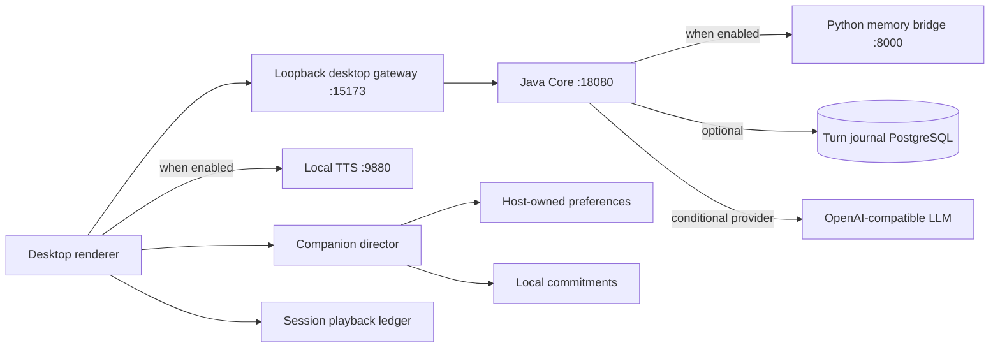

# P2 runtime map and acceptance boundary

This note describes the local desktop path from the checked-in configuration
and launch scripts. It separates application defaults from desktop-launcher
overrides and records what the current automated checks establish. It does not
claim a production deployment or a manual audio/character acceptance run.

## Runtime paths



`ops/scripts/start-meguri-desktop.ps1` starts the Java Core launcher when port
18080 is not listening, starts the desktop gateway on 15173 when needed, and
starts local TTS on 9880 when that port is not listening. The renderer talks to
the loopback gateway, which forwards authenticated requests to Core. TTS and
local commitments are desktop-process features; commitment follow-up does not
run while the desktop is closed. TimePrism reminders remain a separate
server-backed path.

The attention policy is implemented in
`apps/desktop-meguri/src/renderer/services/companion-policy.ts` and
`stores/companion-director.ts`. Host-owned preferences are defined by
`src/shared/companion-contract.ts`; settings are in `components/CompanionSettings.vue`.
Automatic effect receipts live in `services/playback-ledger.ts` and are used by
the speech/presentation consumers. The ledger stores bounded identifiers and
receipt metadata, not speech text. Explicit replay creates a new playback
identity.

## Defaults and launcher overrides

| Concern | Application default | Trusted local launcher behavior |
| --- | --- | --- |
| Core binding | `127.0.0.1:18080` | Keeps the same loopback endpoint |
| Spring profile | `local-mock` | `runtime-postgres-config.ps1` chooses `postgres` only when its dedicated database configuration is valid; explicit `in-memory` forces the local profile |
| LLM | `mock` | Configures the OpenAI-compatible provider when the local key file exists; otherwise inherited environment values or application defaults apply |
| Turn journal | in-memory | Uses PostgreSQL when the dedicated runtime database file is available and valid |
| Execution mode | off | `start-meguri-core.ps1` enables execution mode and Limited ReAct for this local launch |
| Fast path | off | The launcher does not set `MEGURI_FAST_PATH_ENABLED`; it remains off unless explicitly inherited |
| Python memory bridge | disabled | When no explicit setting is inherited, `memory-runtime-config.ps1` enables it only if both required local secret files exist; an explicit environment setting takes precedence |
| Desktop gateway | not part of the Spring application | Loopback port `15173`, forwards to Core at `18080` |
| TTS | not part of the Spring application | Starts local service at `9880` when the port is unused |

These values are read from `java/meguri-core/src/main/resources/application.yml`
and `ops/scripts/start-meguri-core.ps1`,
`ops/scripts/memory-runtime-config.ps1`,
`ops/scripts/runtime-postgres-config.ps1`,
`ops/scripts/start-meguri-desktop.ps1`, and
`ops/scripts/start_local_tts.ps1`. The launcher reads local credential files;
this document records only the configuration boundary, never credential
contents.

## Java response ownership

`TurnResponseCoordinator` now owns response generation and supervision:

- native stream sanitization, aggregation, and ordered `text.delta` emission;
- cancellation checks before an incoming visible delta is persisted;
- first-byte/first-token latency marks and unsupported-token telemetry;
- stream finalization with the existing reply-text fallback;
- alternative candidate comparison and the single-observation fallback.

`TurnOrchestrator` continues to own its public constructors and runtime/control
plane APIs, turn acceptance/idempotency, retrieval and context preparation,
weather context acquisition, lifecycle transitions, journal/replay APIs, and
terminal events. The coordinator applies the acquired weather context to the
first and alternative response. Those remaining seams are intertwined with
session identity, durable state, recovery, and protocol order; they remain candidates for later bounded
extractions after separate contract review. This P2 change does not replace the
event protocol or alter the journal schema.

## Rollback and recovery

The Java extraction is behavior-preserving and has no runtime toggle or data
migration. Reverting it means restoring the previous Core source version and
restarting Core. To run with application defaults, launch Core directly without
the desktop launcher's local execution-mode overrides; configuration supplied
in the environment still takes precedence.

Companion preferences support conservative defaults and reset/undo. Setting
initiative to `off` suppresses unsolicited news while confirmed commitments
remain eligible for quiet follow-up. Disabling history removes persisted
commitment content. Automatic playback claims intentionally suppress replay
after reconnect/reload; use the explicit replay control to play a response
again. If automatic claim persistence fails, the automatic effect is skipped
and its text remains available. Restoring older code should be paired with the
existing settings reset path if the newer presentation policy is unwanted.

Core restart recovery for turns is separate from desktop playback receipts.
The default in-memory journal cannot restore active turns after a Core restart;
the opt-in PostgreSQL runtime path is covered by the separate Turn Runtime
activation runbook. Neither the local commitment timer nor desktop audio
provides an always-on scheduler or cross-process exactly-once guarantee.

## Acceptance evidence and limits

The focused Java regression run for this extraction used JDK 21 and Maven:

```powershell
. 'D:\environment\activate-dev-env.ps1' 21
Set-Location 'D:\program\meguri-pet\java\meguri-core'
& 'D:\environment\maven\runtime\apache-maven-3.9.16\bin\mvn.cmd' -B '-Dtest=DurableNativeStreamingTest,TrainingFeedbackServiceTest' test
```

Result: 14 tests passed, with no failures, errors, or skips. The stream suite
covers native deltas, fallback complete replies, empty and interrupted streams,
cancellation races, deadlines, and terminal ordering. The training suite
covers candidate sampling, alternative-provider failure with single-observation
fallback, archive failure, and preserving the first reply when supervision is
unavailable.

Automated Electron tests with fake playback/audio can verify attention
decisions, persistence, idempotent claims, cancellation generations, and
manual replay behavior. They do not establish that Windows audio starts on a
particular device, that the selected GPT-SoVITS model is installed and
listening, or that expression and speech timing feel synchronized. Those
resource-dependent checks require a real desktop session and must be recorded
separately. No production reminder, remote notification, or external message
was sent as part of this work.
